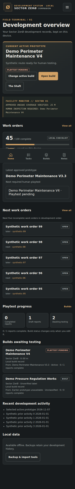
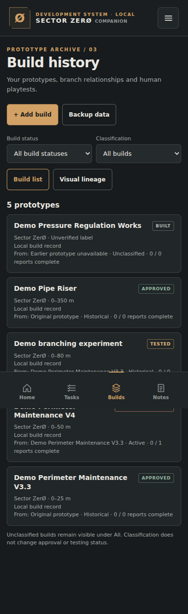
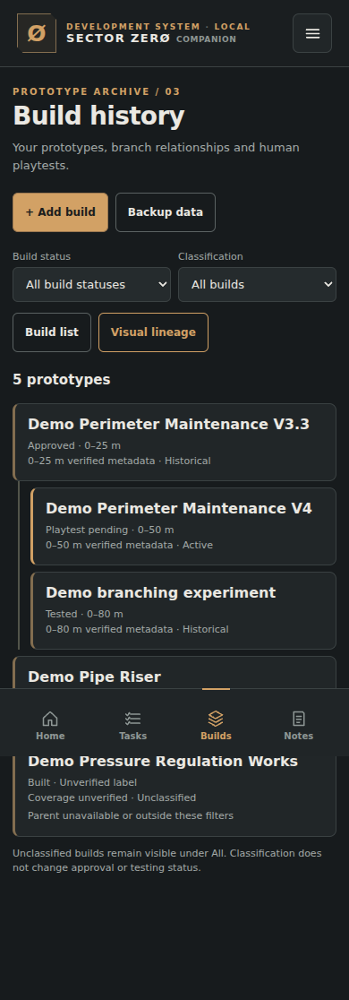
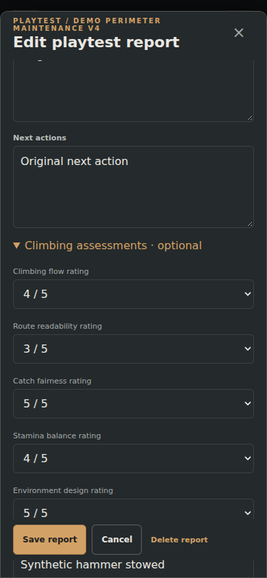
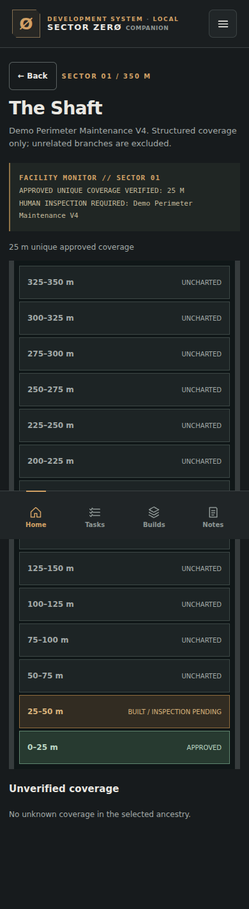
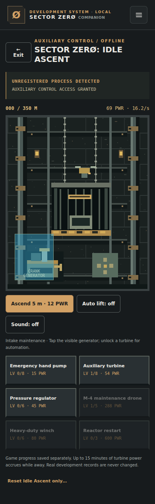

# Sector ZerØ Companion v0.4 — implementation review

**Development preview only. Not merged or deployed.** The installed v0.3 application remains the production release. Release requires the user's explicit approval after review and the Android checks below.

Prepared 7 November 2026. Repository: `tankukosho/sector-zero-companion`. Development branch: **`companion-v0.4`**. Exact deployed v0.3 starting commit: **`141ef90006361171a1e6a0896ec461cabd171b8a`**. The branch was created from that commit before implementation. No changes were made to the Sector ZerØ game repository or GitHub Pages configuration.

## Implemented features

| Area | Result |
| --- | --- |
| Visual build lineage | Switch between the existing build list and a compact tappable branching tree. Names, status and coverage remain visible; independent roots and missing parents remain accessible. Parent choices reject self-reference and descendants. Imported circular relationships are handled without looping; existing references are not silently repaired. |
| Playtests | Existing report fields remain editable. Added five optional 1–5 ratings for flow, route readability, catch fairness, stamina balance and environment design, plus hammer configuration, jump/recovery observations, problems and overall verdict. Draft and Completed remain separate; report completion never approves a build. |
| Home | Explicit active-build picker, selected build status, nearest approved ancestor, next required human test, next five incomplete tasks in Development Order, recent activity and existing statistics. No active build is inferred on upgrade. |
| Build classification | Optional Active/Historical classification is independent of approval and reports. All/Active/Historical filters coexist with the original status filter. Existing unclassified records stay under All. |
| Mobile navigation | History API routes for tabs, records, nested reports, dialogs, Shaft and game. Back restores parent views and filter state; dirty forms ask before discarding and restore their history position on cancellation. Home retains normal browser exit behavior. |
| The Shaft | Fourteen selectable 25 m bands, associated build notes and reports, approved/pending/uncharted states and explicit coverage editing. Progress uses the union of structured intervals in the selected build's ancestry; overlapping intervals are counted once. |
| Facility terminal | Quiet messages derived from saved selection, verified coverage and pending inspection. Missing metadata produces an unknown/unverified fallback. No notifications or record changes. |
| Idle Ascent | Five taps on the header Ø reveal the optional maintenance-lift game. Original pixel canvas machinery, moving lift/cables/piston, six upgrades, turbine automation, M-4 assistance, changing industrial zones and a 350 m endpoint. Clear Exit and Back support; sound defaults off. |

The original four navigation tabs, palette, typography, task sorting and existing app architecture remain. Main-app styling is additive. The game uses original lightweight canvas art and no assets from the private game repository.

## Data model and preservation

IndexedDB remains **`sectorzero-companion`, version 1, object store `records`, key `appstate`**. There is no database migration or automatic rewrite of existing valid state on launch. New records remain unsaved drafts until the user saves. Writes use an atomic state transaction with rollback on storage failure.

| Optional addition | Meaning and handling |
| --- | --- |
| `state.activeBuildId` | Explicit user selection; absent until selected. Selection does not change build status or classification. |
| `build.classification` | `Active` or `Historical`; absent means unclassified. Existing unsupported saved values are retained when editing. |
| `build.heightCoverage` | `{ sector: 1, start: number, end: number }`, with finite `0 <= start < end <= 350`. A single verified interval per build. Titles and old progress labels are never parsed into coverage. Unknown nested fields survive normal edits. Existing invalid/unknown coverage remains intact unless explicitly edited. |
| `report.assessments` | Optional numeric keys `flow`, `readability`, `catchFairness`, `stamina`, `environment`, each 1–5. Unknown assessment keys are preserved. |
| Optional report text | `hammerConfiguration`, `jumpObservations`, `recoveryObservations`, `problems`, `overallVerdict`. Existing report fields and unknown metadata are retained. |
| Isolated game save | LocalStorage key `sectorzero-idle-ascent-v1`. Contains only game version, height, power, taps, upgrade levels, automatic-lift choice and timing. It never writes development records or appears in Companion backups. |

The existing backup envelope remains `sectorzero-companion-backup`, version 1. v0.1/v0.2/v0.3 backups continue to import. Complete exports retain state, original work-order baseline and unknown metadata. Work-order exports retain original array order. View sorting never mutates storage: numeric `dorder`, numeric `order`, then original position for ties. Development Order, Open First and Imported Order all retain search/status/section filtering.

Existing IDs, statuses, task completion, dates, descriptions, builds, parent references, drafts, completed reports and notes are not changed by opening v0.4. Activity history is no longer truncated to 100 when a new action is logged. The public `seed.js` is unchanged and contains zero work orders. Tests and screenshots use synthetic records only. No private checklist, user backup or local device records were used or committed.

## Changed files

| File | Purpose |
| --- | --- |
| `app.js` | Incremental UI, optional fields, dashboard, classification, lineage, reports, navigation, safe saves and Shaft. |
| `index.html` | Added scripts/style references and accessible secret-logo control. |
| `mobile.css` | Additive mobile, safe-area, tree, Shaft, terminal and game styling. |
| `companion-core.js` | Pure ancestry, cycle, interval and game calculations, shared with unit tests. |
| `idle-ascent.js` | Isolated game rendering, controls, saving, lifecycle and optional sound. |
| `sw.js` | Release cache and complete offline asset installation. |
| `package.json` | Preview version, complete test command and local review command. |
| `core.test.cjs` | Empty-seed guard, pure lineage/coverage/game tests. |
| `integration.test.cjs` | Existing archive, reports, backups, storage-error and v0.1 upgrade regressions. |
| `sorting.test.cjs` | Sorting/filter combinations, backup ordering and v0.2 PWA upgrade. |
| `v04.test.cjs` | v0.3 upgrade, all new workflows, mobile navigation, touch, game and preservation tests. |
| `review.cjs` | Loopback-only review server and generated synthetic demo backup. |
| `.gitignore` | Excludes dependencies, private imports, backups and environment files. |
| `README.md` | Preview and safe-review instructions. |
| `IMPLEMENTATION_REPORT.md` | This report and release review checklist. |
| `TEST_RESULTS.txt` | Captured automated results. |
| Six `review-*.png` files | Home, Builds, lineage, playtest editor, Shaft and Idle Ascent screenshots. |

`seed.js`, `styles.css`, the manifest and icons are unchanged from the deployed baseline.

## Automated validation

**The full `npm test` command passed with exit code 0.** See [captured output](TEST_RESULTS.txt). An additional mobile/touch run also passed, including real Playwright tap events and keyboard input. These are local Chromium tests, not execution on the user's Android phone.

| Suite | Verified |
| --- | --- |
| Core | Empty public seed; branching/missing/circular parents; nonmutating interval union; partial/unknown coverage; unrelated historical branch exclusion; game costs, limits, valid saves and suspension catch-up cap. A deterministic strategy reached 350 m in 91 seconds with 178 synthetic taps. This is a balance test, not a promised human completion time. |
| Existing integration | Real v0.1 service-worker baseline upgraded to current; unchanged original state; same DB version; lineage/report editing; Draft/Completed validation; no automatic approval; old backup import/round trip; failed-write rollback; invalid stored state never silently reset. |
| Sorting | Real v0.2 worker upgrade; 81 combinations of sorting, search, status and section filters; numeric strings/ties/invalid order values; original array and backup ordering; preference reload; Home's independent development order; blocked preference storage; empty/completed lists. |
| v0.4 workflows | Actual v0.3 application and worker baseline upgraded offline to current. Synthetic fixture: 100 tasks, 45 complete, 105 activity entries, unknown nested metadata, builds, reports, notes and parent references. Exact state equality after upgrade before edits, then preservation through explicit saves, exports/imports and reload. |
| New behavior | Explicit active selection; classification filters; valid/invalid coverage editing; missing parents/cycle prevention; branch-correct dashboard/terminal; optional assessments and legacy report preservation; 14 Shaft bands and overlapping intervals; game activation, upgrades, saving, exit and exact archive isolation. |

Testing discovered timing issues in inherited asynchronous service-worker assertions. They now explicitly await asynchronous browser conditions and verify cached response contents. New assets are installed sequentially and consumed before proceeding. The final suite passed after these fixes; there are no known failing automated critical tests.

## Navigation and mobile results

Browser Back was exercised on task, build, note and playtest forms, including rejecting and accepting discard confirmations, repeated nested navigation and preserved task filters. Report Back returns to its build; record Back returns to the relevant tab. Shaft band dialogs close before returning from Shaft. Game Back and Exit restore the previous app view. Root Home allowed normal browser exit in the test.

The 390 px portrait viewport, touch-enabled emulation, 390 × 450 shortened viewport, keyboard input and reachable Save action passed. No unwanted horizontal scrolling or uncaught runtime errors were observed. Long editors scroll, actions are sticky, inputs use 16 px text, touch controls have 44 px minimum targets and CSS includes safe-area insets and reduced-motion handling.

This does not prove actual Android hardware Back, keyboard dismissal ordering, gesture insets, browser-specific standalone behavior or OS process suspension. Those remain human release checks below.

## Offline PWA and cache update evidence

The new cache is **`sectorzero-companion-public-v04-3`**, with all 11 application assets. Installation fetches release-tagged URLs with reload semantics and stores responses at canonical offline keys. A failed install deletes its incomplete new cache. Activation waits for old clients to close; there is no forced `skipWaiting` or editor reload. Activation removes earlier Companion caches without touching IndexedDB.

Tests served the actual v0.1, v0.2 and exact deployed v0.3 source/worker baselines, seeded synthetic records, installed the update, closed old clients and reopened offline. Tests positively inspected cached JavaScript for `APP_VERSION='0.4'` and cached HTML for the new core dependency, then verified offline startup and stored state. This checks the contents of the installed release, beyond merely finding a cache with the expected name. Offline reload and records/backup persistence passed.

Production hosting was not used to run these upgrade tests, and v0.4 is not deployed. A deliberately failing asset-install test and real Android OS lifecycle/battery/audio tests have not been performed.

## Screenshots and visual review

All records pictured are synthetic demo fixtures. Screenshots are from a 390 px emulated portrait screen; full-page captures can show the fixed bottom bar partway down the document. Layouts were visually reviewed alongside the automated checks.

### Home

### Builds

### Visual lineage

### Playtest editor

### The Shaft

### Idle Ascent

## Review without replacing v0.3

1. Open this development branch's report/screenshots on Android. This does not install or change the live app.
2. For interactive review on a computer, check out `companion-v0.4` and run `npm run review` with Node 20+. No build step or npm dependencies are needed for the review server.
3. Open `http://localhost:4044/` in a separate browser profile. This loopback origin has separate origin-scoped storage from GitHub Pages even though the DB name is unchanged.
4. Download the synthetic demo backup from the local review banner and import it into that preview using the existing data tools. No private backup is needed. Keep real device records authoritative.
5. To rerun tests: `npm install`, `npx playwright install chromium`, `npm test`. Upgrade tests retrieve public historic source commits. Optional browser overrides are `COMPANION_CHROMIUM_PATH` and `COMPANION_CHROMIUM_ARGS` (JSON array).

Do not change Pages to serve the branch, replace the production installation, clear its site data or serve the preview at the production origin. There is no hosted v0.4 preview URL in this delivery. An Android interactive preview needs a separately approved isolated HTTPS origin; screenshots can be reviewed immediately on the phone.

## Human Android checklist before release

Use only synthetic records on an isolated preview origin first. These items remain outstanding and must not be described as already tested on real hardware.

- Confirm Back: build → Builds; report → parent build; task → Tasks; note → Notes; band dialog → Shaft; Shaft/game → prior view. Repeat Back without loops. Home must allow normal exit.
- Edit each form, press Back, reject discard and confirm all input survives; repeat and accept discard. Test close buttons, backdrop and tab changes. Confirm a report never automatically approves a build.
- With the real Android keyboard open, verify the first system Back dismisses the IME as expected, subsequent Back follows the app route, and Save remains reachable. Check long text, select controls, gesture navigation, safe-area padding and orientation.
- Verify active selection, missing/unclassified builds, status/classification filters, task search and all sorting modes. Confirm original task order and statuses in an exported synthetic backup.
- Open Shaft and verify 0–25 m approved plus 0–50 m pending gives only 25 m approved; unrelated approved experiments do not add progress.
- Tap Ø five times, operate the generator, buy automation, exit/reopen and confirm saved game progress. Confirm sound starts off, reduced-motion works, and real development totals never change.
- On the isolated preview, install the prior-version fixture/update candidate, close all clients after the update downloads, reopen offline and confirm v0.4 with unchanged synthetic archive. Test OS suspension/restore and ensure no excessive activity while hidden.

## Known limits and release decision

- Coverage is one explicit continuous Sector 01 interval per build. Unknown labels remain unverified. The selected branch means the active build plus its ancestors; sibling prototypes are excluded until explicitly selected. Historical ancestors can legitimately contribute verified coverage; unrelated historical roots cannot.
- Game progress is separate device-local storage and intentionally excluded from development backups. Catch-up is capped at 15 minutes, and no game loop runs while hidden/unmounted. Device clearing/uninstall can remove game saves as with other local browser data.
- Real Android standalone navigation, IME, gesture insets, suspension, battery and audio remain unverified. Emulation and source review do not substitute for those checks.
- The user's actual private device archive was not accessed or modified. Preservation evidence comes from synthetic round-trip and exact-state upgrade tests.

**Ready for implementation review, not a release declaration.** Keep production v0.3 running. Do not merge, deploy or change Pages until the user has reviewed this implementation and explicitly approved release. Any critical preservation, backup, navigation, privacy or PWA failure found during review blocks release.
